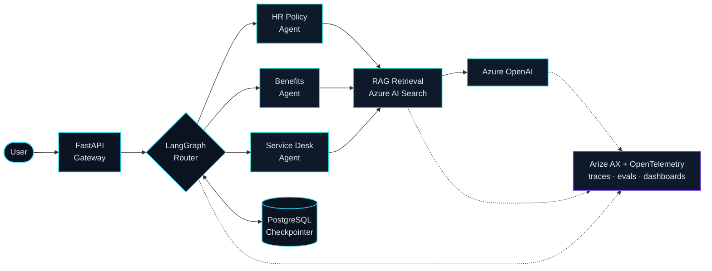

  

  

  

I build the backend for money movement — and the intelligence layer on top of it. Currently at **Tranzita Systems**, where I own credit decisioning and payments for a digital lending marketplace, and the observability layer for a multi-agent LLM assistant running at **Procter &amp; Gamble** scale.

 

## Stack

 

`LangGraph` &nbsp;`LangChain` &nbsp;`RAG` &nbsp;`Azure OpenAI` &nbsp;`Gemini` &nbsp;`Arize AX` &nbsp;`OpenTelemetry` &nbsp;`MCP`

`ONDC / Beckn` &nbsp;`Razorpay` &nbsp;`PhonePe` &nbsp;`Cashfree` &nbsp;`Stripe` &nbsp;`CIBIL` &nbsp;`Experian`

 

## Experience

**Tranzita Systems** — Software Engineer, Backend &amp; AI &nbsp;·&nbsp; June 2025 – Present · Lucknow

<table>
<tr>
<td width="50%" valign="top">

**Samridhya** · Digital Lending Marketplace

- Loan aggregator backend for **12+ NBFCs** — offer aggregation, ranking, de-duplication
- **ONDC** buyer app on the **Beckn protocol**, end to end
- AI credit analyser over CIBIL / Experian / Digitap bureau data
- **Spendly AI** — multi-agent financial assistant on Gemini
- Razorpay, PhonePe and Cashfree integrations

</td>
<td width="50%" valign="top">

**Procter &amp; Gamble** · "Digital Colleague"

- **LangGraph** multi-agent HR assistant on FastAPI + Azure OpenAI, serving P&amp;G globally
- Own **LLM observability** end to end — Arize AX + OpenTelemetry tracing and dashboards
- **RAG** over Azure AI Search with a live-traffic evaluation layer
- Conversation persistence on a **PostgreSQL LangGraph checkpointer**

</td>
</tr>
</table>

 

## Architecture

How the P&amp;G "Digital Colleague" assistant fits together — the system I own observability for.

<b>How a request actually flows</b>

 

1. **Ingress** — request hits the FastAPI gateway; the session is rehydrated from the PostgreSQL LangGraph checkpointer, so chat history survives restarts.
2. **Routing** — the LangGraph router resolves intent and dispatches to the right specialist agent. Ambiguous requests were the subject of a research spike on **LLM agent disambiguation**.
3. **Retrieval** — the agent queries the RAG pipeline over Azure AI Search; retrieved context is scored for **relevance and groundedness on live traffic**.
4. **Generation** — Azure OpenAI produces the response, which is checkpointed back to Postgres.
5. **Observability** — every hop emits OpenTelemetry spans into Arize AX, feeding production dashboards for **agent success rate and latency**.

 

## Selected Work

<table>
<tr>
<td width="50%" valign="top">

**BLIS** · Study Hub Booking Marketplace

Seat-level inventory, subscriptions and QR check-in on a serverless backend. Four-tier RBAC and server-side payment verification. Programmatic SEO drove **500K+ impressions** in three months.

`Next.js` `Node.js` `Firebase` `Cashfree`

<a href="https://libraryinseconds.com"><b>libraryinseconds.com&nbsp;→</b></a>

</td>
<td width="50%" valign="top">

**New Life** · AI Fitness App

Play Store app with a Gemini vision pipeline that estimates nutrition from meal photos, plus Apple HealthKit and Android Health Connect sync.

`React Native` `Expo` `TypeScript` `Gemini`

<a href="https://ad1tya.vercel.app"><b>ad1tya.vercel.app&nbsp;→</b></a>

</td>
</tr>
</table>

Also on GitHub &nbsp;·&nbsp;
<a href="https://github.com/AD1TYA03/ravana_ai">ravana_ai</a> &nbsp;·&nbsp;
<a href="https://github.com/AD1TYA03/autobot-coldmailer">autobot-coldmailer</a> &nbsp;·&nbsp;
<a href="https://github.com/AD1TYA03/NoteCrypt">NoteCrypt</a> &nbsp;·&nbsp;
<a href="https://github.com/AD1TYA03/cut-tracker-app">cut-tracker-app</a>

 

## Education

**B.Tech, Computer Science and Engineering** — SRMCEM, Lucknow &nbsp;·&nbsp; CGPA 8.2/10 &nbsp;·&nbsp; May 2025

 

Open to backend &amp; AI engineering roles &nbsp;·&nbsp;
<a href="mailto:saaditya17@gmail.com">saaditya17@gmail.com</a>

  

